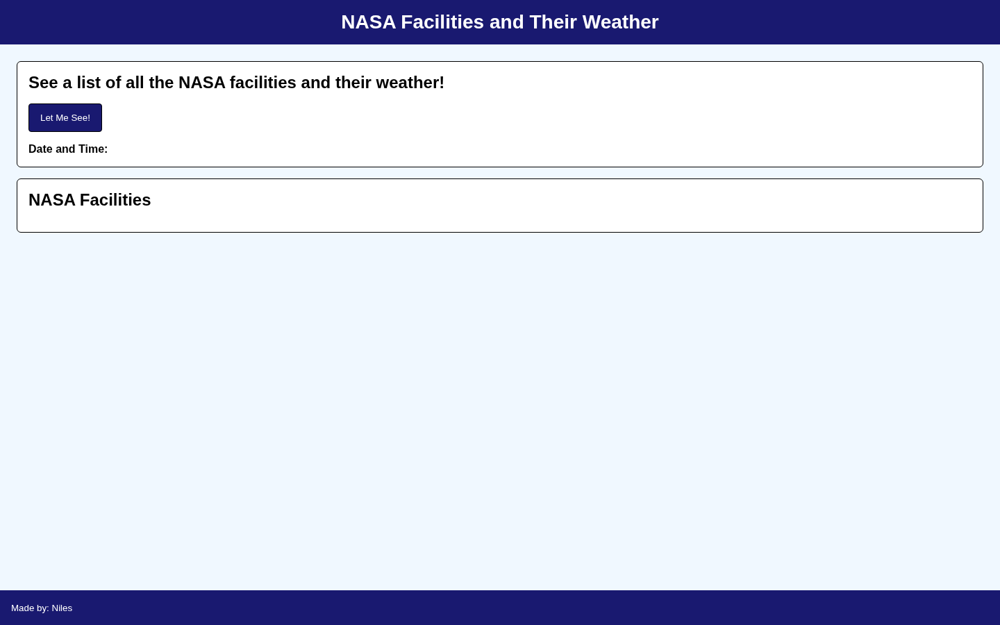

# NASA Facilities and Weather

Combines NASA facility locations with current weather data from Open-Meteo.

## Overview

NASA Facilities and Weather retrieves facility information from NASA and uses each facility's latitude and longitude to request current weather conditions from Open-Meteo.

The application then displays the facility details and weather information together in the browser.

## Features

- Retrieves NASA facility information
- Uses facility coordinates to request current weather data
- Combines information from two external APIs
- Displays facility location details
- Displays apparent temperature, cloud cover, precipitation, humidity, temperature, and wind speed
- Shows the date and time when the data is requested

## Technologies

<p>
  <a href="https://developer.mozilla.org/en-US/docs/Web/HTML" title="HTML">
    
  </a>
  &nbsp;
  <a href="https://developer.mozilla.org/en-US/docs/Web/CSS" title="CSS">
    
  </a>
  &nbsp;
  <a href="https://developer.mozilla.org/en-US/docs/Web/JavaScript" title="JavaScript">
    
  </a>
</p>

- [NASA Facilities dataset](https://data.nasa.gov/dataset/nasa-facilities)
- [Open-Meteo Weather API](https://open-meteo.com/)

## How to Run

1. Clone the repository:

```bash
git clone https://github.com/nilesleesmith/simple-nasa-facilities-weather-report.git
```

2. Open the project folder.

3. Open `index.html` in a web browser.

No additional packages or build steps are required.

## Live Site

https://nilesleesmith.github.io/simple-nasa-facilities-weather-report/

## Screenshots


